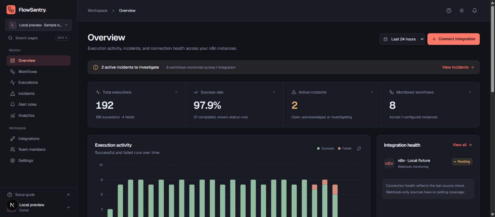
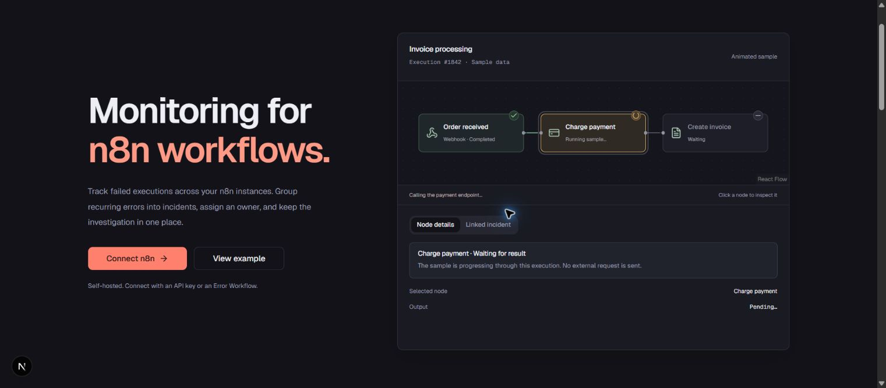
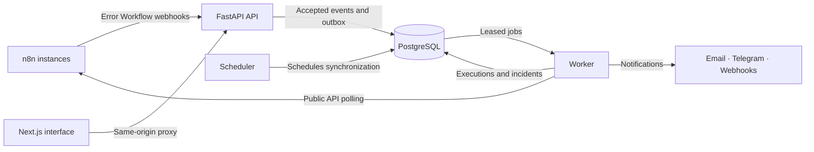

<p align="center">
  
</p>

<h1 align="center">FlowSentry</h1>

<p align="center">
  <strong>Monitoring for n8n workflows.</strong><br>
  Track executions. Investigate failures. Keep your team informed.
</p>

<p align="center">
  <a href="https://github.com/AbdullahZahid123/FlowSentry/actions/workflows/ci.yml"></a>
  <a href="LICENSE"></a>
  <a href="https://github.com/AbdullahZahid123/FlowSentry/stargazers"></a>
  
</p>

<p align="center">
  <a href="#quick-start">Quick start</a> &nbsp;·&nbsp;
  <a href="#what-you-can-do">Features</a> &nbsp;·&nbsp;
  <a href="docs/integrations/n8n.md">Connect n8n</a> &nbsp;·&nbsp;
  <a href="docs/deployment.md">Deployment</a> &nbsp;·&nbsp;
  <a href="#star-history">Star history</a>
</p>

<p align="center">
  <picture>
    <source media="(prefers-color-scheme: dark)" srcset="docs/assets/overview-dark.png">
    <source media="(prefers-color-scheme: light)" srcset="docs/assets/overview-light.png">
    
  </picture>
  <br><sub>Operations overview · Sample workspace · Light and dark themes</sub>
</p>

FlowSentry brings execution history and incidents from your n8n instances into one workspace. Repeated failures are grouped into incidents, so you can inspect the failed node, assign an owner, and track the investigation without sorting through every run.

Run it on your own infrastructure. n8n continues to execute your workflows; FlowSentry monitors them.

## What you can do

| Area | What is included |
| --- | --- |
| **Connect n8n** | API-based discovery and polling, Error Workflow webhooks, connection checks, and sync status. |
| **Inspect executions** | Search and filter runs, inspect redacted error details and source events, and export CSV. |
| **Understand workflows** | View stages derived from the real workflow. Expand each stage to see up to four underlying nodes; branches stay visible. |
| **Manage incidents** | Group repeated failures, set severity, assign owners, acknowledge, investigate, resolve, and leave comments with an activity history. |
| **Send alerts** | Email, Telegram, and webhook channels with rules, cooldowns, retries, and delivery history. |
| **Track health** | Execution trends, success rates, workflow health, expected intervals, and connection health. |
| **Work as a team** | Separate workspaces, role-based access, invitations, account sessions, and audit history. |

Light and dark themes, small-screen layouts, keyboard navigation, and reduced motion are supported. Workflow grouping is deterministic; definitions are not sent to an AI service.

## Quick start

Requires **Docker with Compose** and **Python 3** for the one-time configuration generator.

```sh
git clone https://github.com/AbdullahZahid123/FlowSentry.git
cd FlowSentry
python scripts/configure.py
docker compose up --build -d
```

Open **[localhost:3100](http://localhost:3100)**, choose **Open app**, and create your first owner account. First-run setup closes after that account is created. There is no default password or seeded production activity.

The generator creates a private `.env` with random database, signing, and credential-encryption keys. It refuses to overwrite existing configuration. Keep the encryption key with your protected backups: losing it makes stored n8n credentials unrecoverable.

This starts a local HTTP installation bound to loopback. For a network-accessible deployment, follow the [HTTPS, secure-cookie, and network configuration guide](docs/deployment.md).

## Connect your first n8n instance

1. Open **Integrations → Connect n8n**.
2. Enter your n8n URL and an API key with workflow/execution read access, or choose webhook-only monitoring.
3. Test the connection and synchronize it.
4. Copy the one-time ingress token and configure an n8n Error Workflow using the [connection guide](docs/integrations/n8n.md).
5. Add a notification channel and rule under **Alert rules**.

API access provides workflow discovery, execution reconciliation, and workflow maps. Webhook-only connections receive failures without polling coverage or workflow topology.

Private network destinations are blocked by default. Monitoring an internal n8n instance requires deliberately enabling `ALLOW_PRIVATE_NETWORK=true` and restricting outbound access at the network layer.

## A closer look

<p align="center">
  <picture>
    <source media="(prefers-color-scheme: dark)" srcset="docs/assets/product-dark.png">
    <source media="(prefers-color-scheme: light)" srcset="docs/assets/product-light.png">
    
  </picture>
  <br><sub>The public product preview uses labeled sample data. Connected workspaces show their own records.</sub>
</p>

## How it runs



| Layer | Stack |
| --- | --- |
| Frontend | Next.js, React, TypeScript, Tailwind CSS, shadcn/ui, React Flow, Recharts |
| Backend | FastAPI, SQLAlchemy, Alembic |
| Storage and jobs | PostgreSQL, transactional outbox, leased jobs; no Redis dependency |
| Deployment | Docker Compose with separate API, worker, scheduler, web, and database services |

Cookie sessions, CSRF protection, workspace roles, encrypted integration credentials, payload redaction, and an audit trail are included. See [security](SECURITY.md) for deployment requirements and limits.

## Project status

The monitoring and incident-management MVP is implemented. Local verification includes **33 passing backend tests**, TypeScript checks, production Docker builds, real n8n 2.45.7 integration, SMTP capture, restart durability, and database backup/restore. The live n8n contract test is opt-in; standard CI skips it without a configured instance.

Production hosting and real Telegram delivery have not been verified. Native retry/recovery, AI diagnosis, maintenance windows, SLA escalation policies, and additional providers remain future scope. Unsupported recovery actions stay disabled.

Read the [release coverage](docs/release-status.md) for the verification record and remaining release work.

## Documentation and contributing

| Guide | Contents |
| --- | --- |
| [n8n integration](docs/integrations/n8n.md) | API scopes, Error Workflow setup, capabilities, and network policy |
| [Deployment and operations](docs/deployment.md) | Configuration, migrations, health checks, retention, and backup/restore |
| [Contributing](CONTRIBUTING.md) | Local development, isolated database tests, and UI checks |
| [Security](SECURITY.md) | Security controls, deployment responsibilities, and reporting |
| [Release coverage](docs/release-status.md) | Implemented scope, completed checks, and future phases |

Bug reports and focused contributions are welcome. Include reproduction steps and redact credentials and execution payloads before sharing an issue.

## License

[Apache 2.0](LICENSE). Third-party component notices are in [THIRD_PARTY_NOTICES.md](THIRD_PARTY_NOTICES.md).

FlowSentry is independent of n8n. n8n names and trademarks belong to their owners.

## Star history

<a href="https://www.star-history.com/#AbdullahZahid123/FlowSentry&Date">
  <picture>
    <source media="(prefers-color-scheme: dark)" srcset="https://api.star-history.com/svg?repos=AbdullahZahid123/FlowSentry&amp;type=Date&amp;theme=dark">
    <source media="(prefers-color-scheme: light)" srcset="https://api.star-history.com/svg?repos=AbdullahZahid123/FlowSentry&amp;type=Date">
    
  </picture>
</a>

<sub>The chart uses live GitHub data and may take time to populate for a new repository.</sub>
